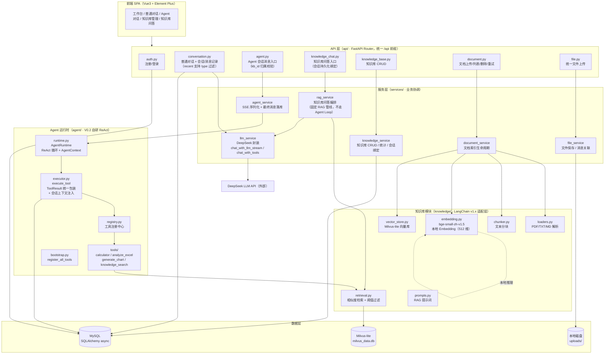
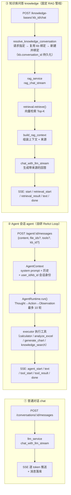
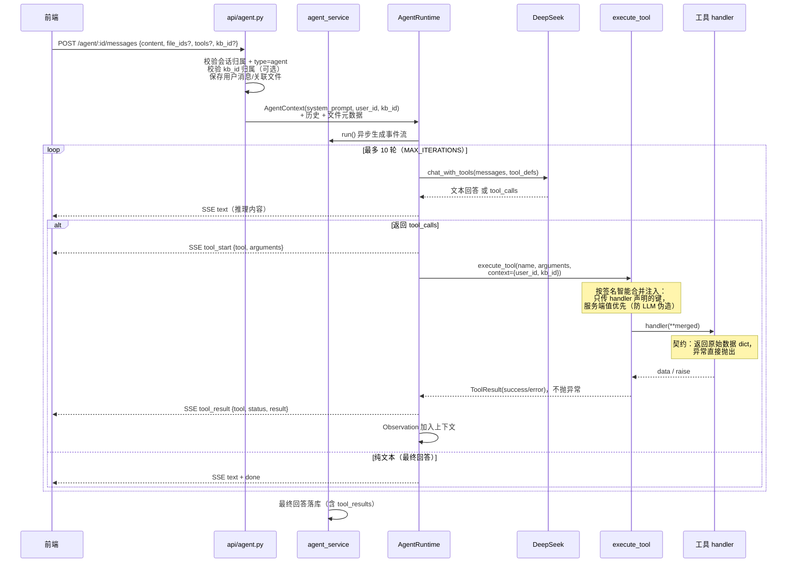
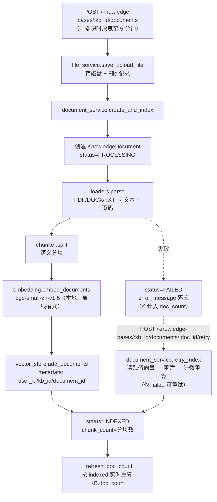
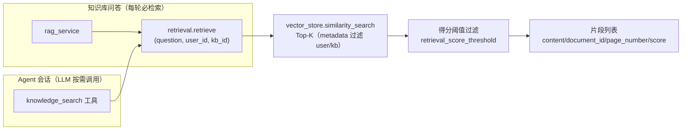
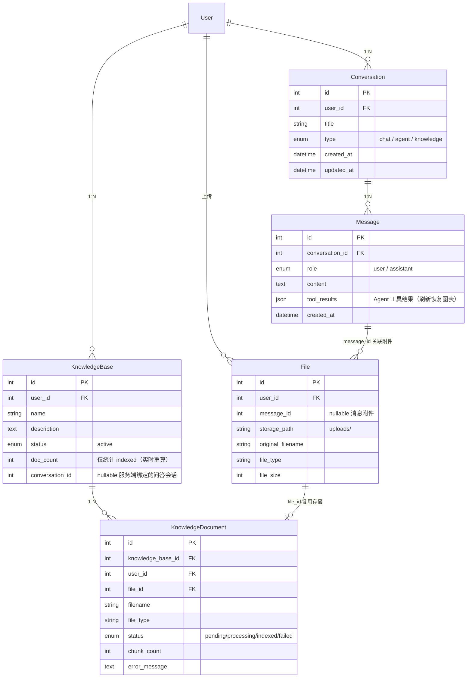

# 后端架构设计总览（V0.3）

> 更新时间：2026-10-22 ｜ 覆盖范围：FastAPI 后端整体架构、三种会话模式、Agent 运行时、知识库（RAG）模块、数据模型

---

## 1. 总体分层架构



**目录结构对应：**

```text
backend/
├── main.py              # 应用入口：lifespan 建表 + 注册工具 + 初始化向量库
├── core/                # 横切：config（Settings）+ security（RSA/JWT 认证）
├── db/                  # async engine + AsyncSessionLocal + get_db
├── models/              # ORM：User / Conversation / Message / File / KnowledgeBase / KnowledgeDocument
├── schemas/             # Pydantic 请求/响应契约（ApiResponse 统一包装）
├── api/                 # 路由层（见上图）
├── services/            # 业务编排层（见上图）
├── agent/               # 自研 Agent 运行时（见第 3 节）
├── knowledge/           # RAG 基础设施（见第 4 节）
└── design/              # 设计文档
```

---

## 2. 三种会话模式（核心业务视角）

`Conversation.type` 区分三种模式，共用同一张 `conversation` / `message` 表和统一会话记录接口（`GET /conversations/recent?type=chat|agent|knowledge`）。



**关键设计说明：**

| 对比项 | 普通对话 | Agent 会话 | 知识库问答 |
|---|---|---|---|
| 入口路由 | `/conversations/:id/messages` | `/agent/:id/messages` | `/knowledge-bases/:kb_id/chat` |
| 编排方式 | 直接调 LLM | 自研 ReAct Loop（LLM 自主决策用工具） | 固定管线（必检索，再生成） |
| 检索 | 无 | 按需（LLM 决定是否调 knowledge_search） | 每轮必检索 |
| 上下文 | 历史消息 | 历史消息 + 工具观察结果 | 检索片段注入 prompt |
| 会话身份注入 | 无 | `AgentContext(user_id, kb_id?)` → executor → 工具 | 路由参数直接携带 kb_id |
| 会话持久化 | 前端传会话 id | 前端传会话 id | 服务端绑定 `kb.conversation_id`，重进自动续接 |

> ⚠️ **澄清**：知识库问答**不经过 Agent Loop**。它是 rag_service 里的固定 RAG 管线；Agent 会话则通过
> `knowledge_search` 工具间接复用同一套检索层。两条链路在 `knowledge/retrieval.py` 汇合。
>
> **Agent 绑定知识库**：请求可选携带 `kb_id`，服务端校验归属后写入 `AgentContext`，由 executor
> 注入工具（服务端值优先，LLM 无法伪造）；未绑定时 knowledge_search 如实返回提示。
> 前端 `AgentStreamParams.kbId` 已接线（Agent 对话页选择知识库的 UI 入口尚未做）。

---

## 3. Agent 运行时（V0.2 自研，非 LangChain Agent）



**核心契约：**

1. **工具注册**：`registry.register(ToolDefinition, handler)`，启动时 `register_all_tools()` 一次性注册；
   Runtime 不感知具体工具，新增工具零侵入
2. **ToolResult 统一包装**：handler 只返回原始数据；executor 负责包装成功/失败，Runtime
   无需 try/except，只读 `result.status`
3. **上下文注入**：`AgentContext` 携带 `user_id/kb_id`（kb_id 来自请求绑定，服务端校验归属）
   → `execute_tool(context=...)` → 按签名过滤注入 → 工具内不暴露给 LLM、不可被 LLM 参数覆盖
4. **无工具退化**：LLM 不返回 tool_calls 时退化为普通对话

---

## 4. 知识库模块（RAG 双链路）

### 4.1 索引链路（文档上传，同步执行）



### 4.2 检索链路（两处消费方共用）



**向量库设计**：Milvus-lite 单文件（`milvus_data.db`），bge-small-zh-v1.5 本地推理（512 维，
`HF_HUB_OFFLINE=1` 离线加载，模型缓存后不联网校验）；metadata 带 `user_id/kb_id` 实现
租户隔离检索。

---

## 5. 数据模型



**统计口径**：`doc_count` 与 `KB.chunk_count`（接口实时 SUM 聚合，仅 indexed）均不冗余存储
计数器易漂移的教训——`doc_count` 已改为上传成功/删除时按状态重算自愈。

---

## 6. 横切关注点与部署约束

| 关注点 | 设计 |
|---|---|
| 认证 | RSA 密钥启动时内存随机生成 + JWT；**必须单进程部署**（多 worker 密钥不一致导致认证失败） |
| 统一响应 | `ApiResponse{code, data, message}` + 全局异常处理器（404/422/500） |
| SSE | 所有流式接口关闭代理缓冲（`X-Accel-Buffering: no`），Nginx 需同步配置；生产环境 `/api` 转发不剥离前缀 |
| 启动初始化 | lifespan：`create_all` 建表 → `register_all_tools()` → `init_collection()` 向量库 |
| CORS | 开发环境放行 `http://localhost:5173` |
| Embedding | hf-mirror 首次下载，本地缓存后 `HF_HUB_OFFLINE=1` 离线加载，避免网络波动 |
| 部署 | Ubuntu 24.04 + Docker Compose，**单进程 uvicorn**（RSA + Milvus-lite 文件锁均要求） |
